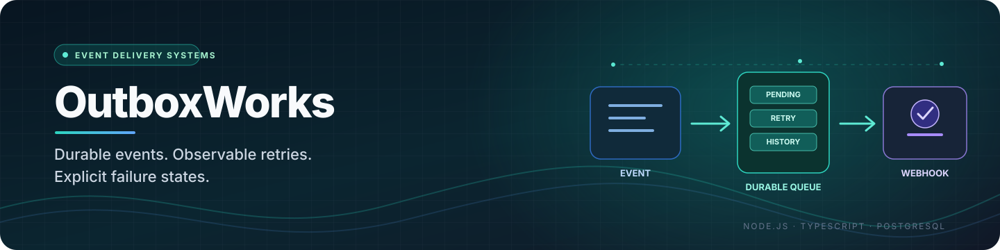

<!--
  OutboxWorks README
  Keep implementation claims aligned with src/, package.json, tests, and docs/.
-->

  

<h1 align="center">OutboxWorks</h1>

  <strong>Durable events. Observable retries. Explicit failure states.</strong> 
  A TypeScript and PostgreSQL webhook-delivery MVP built around idempotent enqueueing, signed requests, retry history, and controlled replay.

  
  
  
  
  

  <a href="#overview">Overview</a> ·
  <a href="#implemented-capabilities">Capabilities</a> ·
  <a href="#delivery-lifecycle">Delivery lifecycle</a> ·
  <a href="#api-reference">API reference</a> ·
  <a href="#local-development">Local development</a> ·
  <a href="#security-audit-and-known-limitations">Security audit</a> ·
  <a href="#roadmap">Roadmap</a>

---

> [!CAUTION]
> **Local portfolio MVP — not safe to expose to the public internet.** This source audit found multiple release blockers: the declared API start command points to a missing `src/server.ts`, most routes have no authentication, an unset admin secret falls back to a known value, endpoint secrets are stored as plaintext, the dashboard renders endpoint URLs through `innerHTML`, and the SSRF check is vulnerable to DNS time-of-check/time-of-use gaps. No GitHub Actions workflow is currently present. These findings are documented below rather than hidden behind a “production-ready” claim.

## Overview

OutboxWorks explores a small but important reliability problem: when one application needs to notify another over HTTP, the receiver may be unavailable, a request may time out, or the sender may lose its connection after the receiver has already processed the event. A plain HTTP request is not a durable delivery system.

The project implements the core pieces of a database-backed webhook pipeline: an event is accepted idempotently, a delivery record is stored in PostgreSQL, a worker claims eligible work, requests are signed with HMAC-SHA256, failed attempts are scheduled for retry, and exhausted deliveries enter a dead-letter state. A small monitoring page exposes registered endpoints and recent delivery states.

The implementation is useful for studying transactional enqueueing, worker coordination, retry semantics, webhook signing, and the security boundary around user-supplied destination URLs. It is a **learning/portfolio MVP**. It is not a managed webhook platform, and its current access-control and deployment gaps make it unsuitable for production use.

## Implemented capabilities

| Area | Current implementation | Important boundary |
|---|---|---|
| Endpoint registration | `POST /endpoints` validates a URL and requires a secret of at least 16 characters | Route is unauthenticated; secret is stored in plaintext |
| Durable event enqueue | `POST /events` validates the request and writes the event and pending delivery in one PostgreSQL transaction | No producer identity or authorization is enforced |
| Idempotency | Unique constraint on `(endpoint_id, idempotency_key)`; duplicate submissions do not create another event | Duplicate response does not return the original event ID |
| Worker coordination | PostgreSQL row claiming with `FOR UPDATE SKIP LOCKED`; stale `IN_PROGRESS` claims can be recovered after their lease expires | Worker holds a database transaction while sending the external HTTP request |
| Signed delivery | HMAC-SHA256 signature containing a timestamp and signature digest, sent in `OutboxWorks-Signature` | Receivers must implement verification and their own idempotent side-effect handling |
| Timeout and redirects | Five-second request timeout in the worker; redirects are rejected | Network egress policy and destination validation need more hardening |
| Retry policy | Failed requests are rescheduled with bounded exponential backoff; the fifth failed attempt is dead-lettered | The current worker uses a fixed five-attempt limit rather than endpoint-specific policy |
| Attempt history | Records response status, duration, and an error reason for attempts | No dedicated HTTP route exposes the complete attempt history |
| Dead-letter replay | `POST /deliveries/:id/replay` resets a dead-lettered delivery and writes an audit event | Current authentication fallback is insecure; do not deploy as-is |
| Monitoring API | Lists registered endpoints and the latest 50 deliveries | No authentication, pagination/filtering, or full operational dashboard contract |
| Dashboard | Server-served HTML page for endpoint and recent-delivery monitoring | Minimal UI; endpoint URL rendering has a stored-XSS risk |
| Tests | Node.js test files cover enqueue/idempotency, signature verification, and selected SSRF cases | Tests require a configured PostgreSQL database; SSRF tests also depend on external DNS/network access. They were not executed as part of this documentation audit |

## Delivery lifecycle

~~~mermaid
flowchart TD
    A[Producer] --> B[POST /events]
    B --> C{Valid payload and endpoint?}
    C -- No --> D[Reject request]
    C -- Yes --> E[PostgreSQL transaction]
    E --> F[Insert event and PENDING delivery]
    F --> G[Worker claims row with SKIP LOCKED]
    G --> H[Sign payload with HMAC-SHA256]
    H --> I[Send HTTP POST]
    I --> J{2xx response?}
    J -- Yes --> K[DELIVERED]
    J -- No / timeout --> L{Attempt limit reached?}
    L -- No --> M[SCHEDULED with backoff]
    M --> G
    L -- Yes --> N[DEAD_LETTERED + audit event]
    N --> O[Authorized replay workflow]
    O --> G
    K --> P[Monitoring API]
    N --> P
    P --> Q[Dashboard]
~~~

The worker currently polls at a two-second interval when no eligible delivery is found. Eligible rows are claimed in a transaction using `FOR UPDATE SKIP LOCKED`, which helps multiple worker processes avoid intentionally claiming the same active row. A claim whose `locked_until` has expired can be recovered.

### Delivery states

| State | Meaning |
|---|---|
| `PENDING` | Enqueued and waiting for a worker |
| `IN_PROGRESS` | Claimed by a worker; a lease timestamp is recorded |
| `SCHEDULED` | Failed and waiting for its next retry time |
| `DELIVERED` | The receiver returned a successful HTTP status |
| `DEAD_LETTERED` | The attempt limit was reached; manual replay is possible through the replay route |

### Delivery guarantees: at-least-once, not exactly-once

OutboxWorks records work durably before attempting the outbound request, but it cannot guarantee exactly-once execution by a remote receiver. A receiver can process a request and the sender can still lose the response or fail before the database transaction is committed. That delivery may be attempted again.

Treat the system as **at-least-once delivery attempts**. Receivers should verify the signature, enforce their own idempotency for side effects, and avoid treating a successful HTTP response alone as proof that the overall business workflow is exactly once.

## Architecture

~~~mermaid
flowchart LR
    subgraph API[Producer API]
      A[Express + Zod]
      B[URL policy check]
      C[Transactional enqueue]
      A --> B
      B --> C
    end
    subgraph DB[PostgreSQL]
      E[(events)]
      D[(deliveries)]
      T[(delivery_attempts)]
      AU[(audit_events)]
    end
    subgraph Worker[Delivery worker]
      W[Claim with SKIP LOCKED]
      S[HMAC signer]
      H[HTTP sender]
      R[Retry / dead-letter transition]
      W --> S --> H --> R
    end
    subgraph Monitor[Monitoring]
      M[Read-only-style JSON routes]
      UI[Static HTML dashboard]
      M --> UI
    end
    C --> E
    C --> D
    D --> W
    R --> D
    R --> T
    R --> AU
    E --> M
    D --> M
~~~

### Persistence model

| Table | Responsibility |
|---|---|
| `endpoints` | Destination URL, endpoint secret, and creation timestamp |
| `events` | JSON payload and producer-supplied idempotency key, scoped to an endpoint |
| `deliveries` | Current delivery state, attempt count, next-attempt time, lock lease, and timestamps |
| `delivery_attempts` | Per-attempt response status, duration, error reason, and creation time |
| `audit_events` | Dead-letter transition and manual replay events |

The SQL schema is in `src/schema.sql`. The migration script reads and executes that schema in a database transaction. This is a simple initial schema bootstrap, not a versioned migration framework.

## API reference

The current API surface is defined in `src/api.ts`.

| Method | Route | Purpose |
|---|---|---|
| `POST` | `/endpoints` | Register a webhook destination |
| `POST` | `/events` | Enqueue a JSON event with an endpoint ID and idempotency key |
| `POST` | `/deliveries/:id/replay` | Requeue a dead-lettered delivery and add an audit event |
| `GET` | `/api/endpoints` | List endpoint URLs and creation timestamps |
| `GET` | `/api/deliveries` | List the latest 50 delivery states and attempt counts |

**Access-control warning:** only the replay endpoint checks a bearer secret, and its code currently uses the known value `dev-admin-secret` whenever `ADMIN_SECRET` is absent. The other endpoints—including endpoint registration, event enqueue, and monitoring reads—do not authenticate callers. Do not expose this API outside a trusted local environment.

### Example: register an endpoint

The endpoint secret is used to sign delivery requests. Replace the sample with a unique secret stored securely for local development.

~~~json
{
  "url": "https://receiver.example.com/webhooks/outboxworks",
  "secret": "replace-with-a-unique-secret-at-least-16-chars"
}
~~~

Send that JSON to `POST /endpoints`. The URL must pass the current SSRF policy. The response contains the generated endpoint ID and URL.

### Example: enqueue an event

Use the UUID returned by endpoint registration.

~~~json
{
  "endpoint_id": "REPLACE_WITH_ENDPOINT_UUID",
  "payload": {
    "event": "invoice.created",
    "invoice_id": "demo-invoice-001"
  },
  "idempotency_key": "invoice.created:demo-invoice-001"
}
~~~

Send the JSON to `POST /events`. A new event and its `PENDING` delivery are inserted atomically. A repeated key for the same endpoint returns an idempotent acceptance response without inserting another event.

### Signature format

The worker sends a signature header in this format:

~~~text
OutboxWorks-Signature: t=<timestamp>,v1=<hex-digest>
~~~

The digest is an HMAC-SHA256 over the timestamp, a dot, and the exact serialized JSON payload. The current timestamp is in **milliseconds**. The utility in `src/signer.ts` includes a five-minute default timestamp tolerance and uses constant-time comparison for the digest. A receiver must verify the signature against the exact request body and reject stale timestamps; possession of the header alone is not proof of authenticity.

## Technology stack

| Layer | Technology |
|---|---|
| Runtime | Node.js 24.x is the documented development baseline |
| Language | TypeScript, ES modules |
| HTTP API | Express 5 |
| Input validation | Zod |
| Durable storage | PostgreSQL, accessed through `pg` |
| Destination IP parsing | `ipaddr.js` |
| Environment configuration | `dotenv` with Zod-based validation |
| Test runner | Node.js built-in test runner through `tsx` |
| Dashboard | Static HTML, CSS, and browser JavaScript served by Express |
| License file | MIT |

The repository has no committed Docker Compose setup and no GitHub Actions workflow at the audited revision. The development setup uses a locally managed PostgreSQL instance.

## Local development

These steps prepare the database and run the available test/worker commands on Windows PowerShell. **The API entrypoint needs to be repaired before the full application and dashboard can be started through the declared npm script.** That is an implementation gap in the current source, not a database setup issue.

### Prerequisites

- Git
- Node.js 24.x and npm
- PostgreSQL 16.x (the documented local baseline)
- PostgreSQL client tools, including `psql`
- Windows PowerShell

### 1. Clone and install dependencies

~~~powershell
git clone https://github.com/tracolerd/outboxworks.git
Set-Location .\outboxworks

npm ci
~~~

### 2. Configure a local database

Create a private local environment file and replace the sample password with the credentials for your own PostgreSQL role.

~~~powershell
Copy-Item .env.example .env
notepad .env
~~~

The example file uses local development defaults. Do not reuse sample credentials in a shared environment, commit the real `.env` file, or publish it in screenshots/issues.

Create the database if it does not already exist:

~~~powershell
psql -U postgres -c "CREATE DATABASE outboxworks;"
~~~

If PostgreSQL uses a different local username, use that role in the command and in `.env`. If the database already exists, keep it and do not recreate it just to follow this guide.

### 3. Initialize the schema

From the repository root, run:

~~~powershell
npm exec tsx -- src/migrate.ts
~~~

The script executes `src/schema.sql`. It expects the environment variables from `.env` to be valid and the database to be reachable.

### 4. Run the tests

~~~powershell
npm test
~~~

The API integration test writes records to PostgreSQL, and the URL-policy tests perform DNS lookups for public hostnames. Use a disposable development database and allow the test process to reach DNS/network services. The test files do not constitute end-to-end coverage of retry behavior, worker recovery, the browser dashboard, or production security.

### 5. Worker and API startup status

The worker command is declared as:

~~~powershell
npm run worker
~~~

It starts a polling process and expects a working PostgreSQL connection and initialized schema. Stop it with Ctrl+C.

The declared API command is `npm start`, which maps to `tsx src/server.ts` in `package.json`; however, **`src/server.ts` is absent from the repository at the audited revision**. The Express app is exported by `src/api.ts`, but the committed project does not include the entrypoint that calls `app.listen(...)`. As a result, the standard API startup command—and therefore the normal server-served dashboard workflow—is currently broken. Add and test an explicit server entrypoint before considering the project ready for a full local demonstration.

## Tests and verification

The repository includes three test files:

- `src/api.test.ts` exercises endpoint creation, event enqueueing, invalid endpoint IDs, duplicate idempotency keys, and persisted delivery state.
- `src/signer.test.ts` checks valid signatures, payload tampering, wrong secrets, and expired timestamps.
- `src/ssrf.test.ts` checks selected public destinations, loopback/private destinations, a link-local metadata IP, and invalid URL protocols.

This is useful starter coverage, but it is not proof of production reliability or security. The API test depends on a real PostgreSQL database. The SSRF tests rely on DNS/network behavior. The suite does not comprehensively test multiple workers, retry timing, stale-claim recovery, dead-letter replay authorization, the browser UI, or malicious DNS changes.

**Verification status for this README update:** source and configuration were inspected, but the tests were not executed during this documentation audit. No passing test count or green CI status is claimed. The repository currently has no checked-in `.github/workflows/ci.yml` workflow.

## Security audit and known limitations

This section is intentionally explicit. The findings below are visible in the current source and should be treated as release blockers for any network-exposed deployment.

### Critical: authorization and secrets

1. **Most API routes are unauthenticated.** A caller can register endpoints, enqueue events, and read monitoring data without an identity or authorization check. Add a defined trust boundary and enforce authentication/authorization before exposing the service.
2. **The replay route has an unsafe default secret.** If `ADMIN_SECRET` is unset, the code accepts the well-known bearer value `dev-admin-secret`. Remove the fallback and fail closed when the secret is absent; preferably replace the shared secret with a proper administrative identity/authorization design.
3. **Endpoint secrets are stored as plaintext.** The `endpoints.secret` database column stores the signing secret directly. Restrict database access and move toward encryption or a dedicated secret store before using real endpoint credentials.
4. **The dashboard has a stored-XSS risk.** Endpoint URLs returned from the API are interpolated into `innerHTML` instead of being rendered as text nodes. Escape/untrusted-data-harden the UI and test URL inputs containing HTML-like characters.

### Critical: SSRF and outbound network policy

5. **Destination validation happens at registration, not at send time.** The URL is resolved and checked when an endpoint is created, but the worker later calls `fetch` independently. DNS records can change between validation and connection (a time-of-check/time-of-use gap). Revalidate and pin safe resolved addresses at connection time, check all resolved addresses, and design explicitly against DNS rebinding.
6. **The policy is a denylist, not a network egress boundary.** It blocks several private, loopback, link-local, and reserved address classes, and the sender rejects redirects. That is useful defense-in-depth, but not a substitute for a robust resolver/connection strategy and outbound firewall policy.
7. **No rate limiting or quota model is implemented.** Once an endpoint is registered, requests can create durable work. Add authentication, abuse controls, payload limits, and quotas before making the API reachable by untrusted producers.

### Reliability and operational gaps

8. **The API server entrypoint is missing.** The npm start script points to a file that is not committed, so the documented full-stack startup path does not currently work.
9. **The worker keeps a database transaction open while performing an external HTTP request.** This pins a connection and holds database locks across network I/O. Separate the claim/lease transaction from the outbound request and use a carefully tested lease/recovery protocol.
10. **The delivery process is at-least-once.** Receivers may observe duplicates when a request succeeds remotely but its outcome is not durably recorded locally. Receiver-side idempotency is required; exactly-once execution is not guaranteed.
11. **Monitoring is minimal.** The dashboard only displays endpoints and the latest 50 deliveries. There is no authentication, pagination/filtering, full attempt-history route, comprehensive audit viewer, or operational alerting.
12. **CI and end-to-end verification are missing.** No workflow currently runs install, type-check/build, tests, and a database-backed integration suite on pushes or pull requests. Add a reproducible CI database service and deterministic tests before presenting the implementation as verified.

### Repository and package metadata

13. **Package metadata is stale.** The npm package description contains old README/banner markup, the package declares `ISC` while the root `LICENSE` is MIT, and the declared `main` entry `index.js` is not present. These fields should be reconciled with the actual project.
14. **Schema setup is a one-shot bootstrap, not a migration history.** The script executes the full schema file; future schema changes need versioned, repeatable migrations and an explicit upgrade/rollback strategy.
15. **No production operations story is included.** TLS termination, secret rotation, backups/restoration, structured metrics/logging, graceful shutdown, retention, monitoring, and deployment hardening have not been established by this repository.

Use synthetic events and unique development-only secrets. Keep the API bound to a trusted local environment. Do not interpret a passing unit test, a successful webhook, or a visible dashboard as proof that the service is production-safe.

## Roadmap

### P0 — Make the local MVP run safely

- [ ] Add and test `src/server.ts`; ensure `npm start` launches the API and dashboard.
- [ ] Remove the hard-coded replay-secret fallback and fail closed when admin configuration is missing.
- [ ] Add authentication/authorization to endpoint creation, event enqueue, replay, and monitoring routes.
- [ ] Render endpoint values as text, not raw HTML; add a regression test for malicious URL strings.
- [ ] Harden SSRF protection against multi-address DNS answers and DNS rebinding at the actual connection boundary.
- [ ] Stop storing endpoint signing secrets in plaintext.

### P1 — Improve delivery reliability

- [ ] Separate row claiming from network I/O while preserving safe lease recovery.
- [ ] Add worker tests for retries, concurrency, stale locks, dead-letter transition, and replay.
- [ ] Expose attempt history and audit events through protected API routes.
- [ ] Add payload limits, rate limits, request validation, structured logs, and graceful shutdown.
- [ ] Build a versioned database migration strategy.

### P2 — Verify and maintain

- [ ] Add GitHub Actions for install, formatting/type checks, unit tests, PostgreSQL-backed integration tests, and a smoke test.
- [ ] Make tests deterministic and avoid dependence on live public DNS wherever possible.
- [ ] Reconcile package name, description, entrypoint, and license metadata.
- [ ] Document deployment, secret rotation, backups, and recovery only after those workflows are implemented and tested.

## Repository layout

~~~text
.
├── assets/
│   └── outboxworks-banner.svg
├── docs/
│   ├── DECISIONS.md
│   └── PROJECT_STATE.md
├── public/
│   └── index.html          # Minimal monitoring dashboard
├── src/
│   ├── api.ts              # Express routes and request validation
│   ├── api.test.ts         # Database-backed enqueue/idempotency test
│   ├── config.ts           # Environment validation
│   ├── db.ts               # PostgreSQL connection pool
│   ├── health.ts           # PostgreSQL connectivity check
│   ├── migrate.ts          # Initial schema bootstrap
│   ├── schema.sql          # Durable outbox and history tables
│   ├── sender.ts           # HTTP delivery, timeout and redirect policy
│   ├── signer.ts           # HMAC-SHA256 signing and verification
│   ├── signer.test.ts      # Signature checks
│   ├── ssrf.ts             # Destination URL validation
│   ├── ssrf.test.ts        # Selected SSRF policy tests
│   └── worker.ts           # Claim, delivery, retry and dead-letter loop
├── .env.example
├── package.json
├── package-lock.json
└── LICENSE
~~~

---

## Creator, Developer & Maintainer

**Created, designed, developed, and maintained by [Nurul Faiyaz](https://github.com/tracolerd).**

This is an independently built portfolio project.

  
  
  
  
  
  
  

  <a href="https://www.facebook.com/faiyaz.888">Facebook</a> ·
  <a href="https://www.instagram.com/tracolerd">Instagram</a> ·
  <a href="https://www.linkedin.com/in/faiyaz-xyz">LinkedIn</a> ·
  <a href="https://x.com/faiyaz_explores">X / Twitter</a> ·
  <a href="https://github.com/tracolerd">GitHub</a> ·
  <a href="mailto:scrollfaiyaz@gmail.com">Email</a> ·
  <a href="https://nurul-faiyaz.netlify.app/">Portfolio</a>

## License

The repository includes an MIT license. See [LICENSE](LICENSE).
